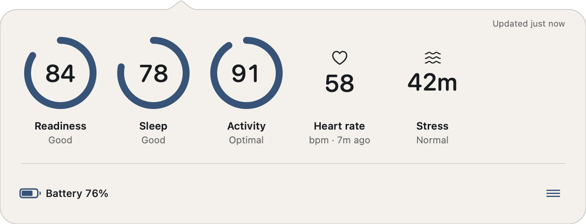
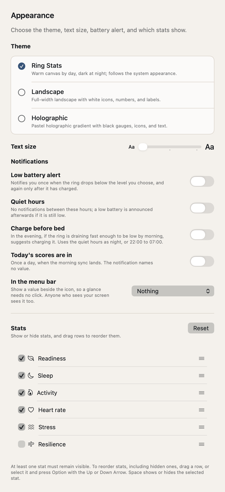
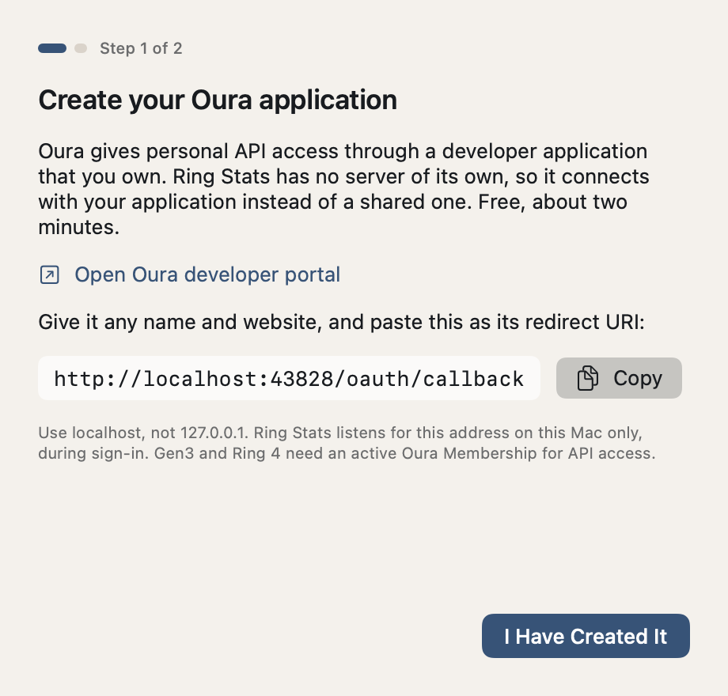
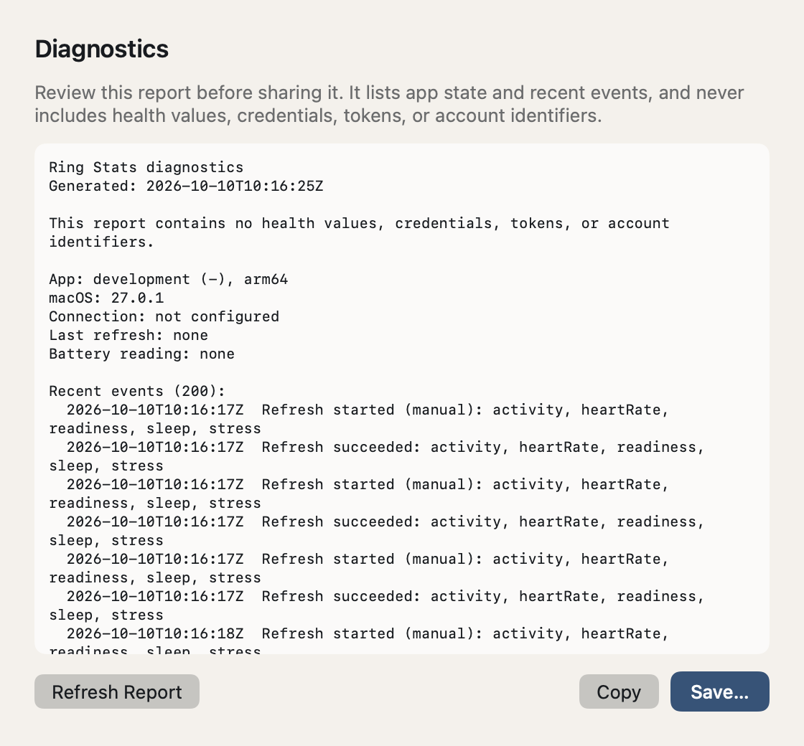
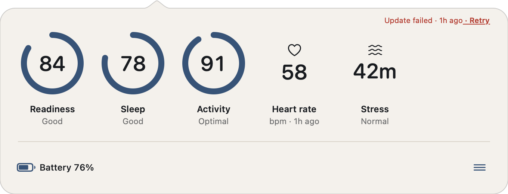

# Ring Stats user guide

Everything Ring Stats does, screen by screen. The screenshots are rendered
by the app from synthetic test data; none of the values are anyone's health
data. Each picture follows GitHub's light or dark mode, as the app follows
macOS.

- [The popover](#the-popover)
- [The menu](#the-menu)
- [Appearance](#appearance)
- [Connection](#connection)
- [Diagnostics](#diagnostics)
- [Refreshing and freshness](#refreshing-and-freshness)
- [Shortcuts](#shortcuts)
- [Keyboard reference](#keyboard-reference)

## The popover

Click the split-ring icon in the menu bar to open the popover. Right-click
or Control-click the icon to open [the menu](#the-menu) directly. Escape
closes the popover; so does clicking anywhere else.

<p align="center">
  <picture>
    <source media="(prefers-color-scheme: dark)" srcset="../.github/assets/guide/popover-dark.png">
    
  </picture>
</p>

- **Stat tiles.** One tile per stat you have chosen to show: Readiness,
  Sleep, Activity, Heart rate, Stress, and Resilience. Each shows today's
  value and a short detail line. The gauge color follows Oura's score bands.
- **Ring battery.** The last battery level the Oura app reported, and whether
  the ring was charging.
- **Status line.** When the data was last updated, for example "Updated 2m
  ago". It is a button: click it to refresh.
- **☰ button.** Opens [the menu](#the-menu).
- **Resizing.** Drag the popover's left or right edge. Tiles that do not fit
  scroll sideways.

A tile says **Not published** when Oura has not published that stat for
today yet. Daily scores arrive after the ring syncs with the Oura app on your
phone, usually after you wake up; when every tile is waiting, the popover says
so under the stats. A tile says **Needs access** when the stat is not covered
by the permissions you granted; click **Enable … Access** under the stats to
grant it, or choose **Reauthorize Permissions** from the menu, which does the
same.

## The menu

Open it from the ☰ button in the popover, or by right-clicking the menu-bar
icon.

| Item | What it does |
|---|---|
| **Appearance…** | Opens the [Appearance](#appearance) window. |
| **Connection…** | Opens the [Connection](#connection) window. |
| **About Ring Stats** | Version, credits, and links to GitHub, the privacy policy, and releases. |
| **Diagnostics…** | Opens the [Diagnostics](#diagnostics) window. |
| **Refresh Now** (⌘R) | Fetches today's data now. Reads "Refreshing…" while it runs. |
| **Reauthorize Permissions** | Opens your browser so you can grant Oura access again, for example after enabling a stat that needs a new permission. |
| **Quit Ring Stats** (⌘Q) | Quits. Your settings and connection stay in place. |

## Appearance

Choose the theme, the text size, the low battery alert, what shows in the
menu bar, and which stats show in what order.

<p align="center">
  <picture>
    <source media="(prefers-color-scheme: dark)" srcset="../.github/assets/guide/appearance-dark.png">
    
  </picture>
</p>

- **Theme.** Ring Stats is a warm canvas by day and dark at night, following
  the system appearance. Landscape is always dark, with a full-width
  landscape behind white gauges. Holographic is always light, with a pastel
  gradient behind black gauges. All three show the same information.
- **Text size.** Standard, Large, or Extra Large. It scales the type and the
  tiles everywhere in the app, independent of any macOS setting.
- **Notifications.** All off by default; macOS asks you to allow them the
  first time you turn one on. **Low battery alert** notifies you once when
  the ring drops below the level you choose (10% to 30%, 20% by default), and
  not again until it has charged. **Quiet hours** hold notifications between
  the hours you set; a ring that is still low afterwards is announced then.
  **Charge before bed** watches today's drain and, in the evening, suggests
  charging when the ring would be low by morning. **Today's scores are in**
  notifies you once a day when the morning sync lands, without naming a
  value.
- **In the menu bar.** A value beside the icon, so a glance needs no click:
  Nothing, Readiness, Sleep, Activity, Heart rate, or the battery percentage
  only when it is low. Anyone who sees your screen sees it too, which is why
  it is off by default.
- **Stats.** Tick a stat to show it, untick to hide it. Drag the handle at
  the right of a row to reorder, or select a row and press Option with the
  Up or Down Arrow. At least one stat must stay visible. Hidden stats are
  not fetched from Oura. **Reset** restores the default set and order.

## Connection

Ring Stats connects through an Oura developer application that you own, so
there is no Ring Stats server and no shared secret. The Connection window
walks you through it the first time, in two steps.

<p align="center">
  <picture>
    <source media="(prefers-color-scheme: dark)" srcset="../.github/assets/guide/connection-dark.png">
    
  </picture>
</p>

1. **Create an application** in the
   [Oura developer portal](https://developer.ouraring.com/applications).
   Any name and website work. Paste this as its redirect URI, exactly as
   written; Oura accepts `localhost` but not `127.0.0.1`, and the window
   has a Copy button for it:

   ```text
   http://localhost:43828/oauth/callback
   ```

   Gen3 and Ring 4 need an active Oura Membership for API access.
2. **Enter the credentials.** Open the application in the portal and paste
   its Client ID and Client Secret. They go into your Mac's Keychain and
   nowhere else. Your browser opens so you can approve access; Ring Stats
   asks only for the permissions the stats you show need. If the browser
   shows an error instead, the usual cause is a redirect URI that does not
   match step 1 exactly.

Then **Connected**: choose **Show My Stats** and the popover fills in. Today's
scores appear once your ring has synced with the Oura app, usually after you
wake up; until then the tiles say **Not published** and the status line says
so.

Once connected, the window offers two actions. **Reauthorize Permissions**
runs the browser approval again, which you need after enabling a stat that
requires a new permission, or when Oura reports the authorization has
expired. **Disconnect & Delete Local Data** revokes the authorization and
removes the credentials and tokens from the Keychain; do this before
uninstalling.

## Diagnostics

A plain-text report for bug reports and support. Review it before sharing:
it lists the app version, macOS version, connection state, when data was
last fetched, and recent events, and never includes health values,
credentials, tokens, or account identifiers.

<p align="center">
  <picture>
    <source media="(prefers-color-scheme: dark)" srcset="../.github/assets/guide/diagnostics-dark.png">
    
  </picture>
</p>

**Refresh Report** regenerates it, **Copy** puts it on the clipboard, and
**Save…** writes it to a file of your choosing.

## Refreshing and freshness

Ring Stats refreshes in the background every 30 minutes. On battery power or
in Low Power Mode it waits until the data is two hours old. **Refresh Now**
in the menu, ⌘R, or a click on the status line fetches immediately.

<p align="center">
  <picture>
    <source media="(prefers-color-scheme: dark)" srcset="../.github/assets/guide/popover-failed-dark.png">
    
  </picture>
</p>

The status line never hides a problem. After a failed update it reads
"Update failed · 1h ago · Retry", and Retry is a click away. A stat that
fails to refresh while others succeed keeps its last value and shows its
age, for example "Stale · 2h". The battery reading is kept for a day and
then dropped rather than shown stale.

## Shortcuts

Two actions appear in the Shortcuts app under Ring Stats, and through
Shortcuts in Raycast, Alfred, and Stream Deck:

- **Get Ring Stat** returns today's value for a stat you name. It fetches the
  stat even if it is hidden in Appearance.
- **Get Ring Battery** returns the ring's battery percentage.

Both need Ring Stats to be connected; the result says what to do if it is
not.

## Keyboard reference

Everything works without a pointer, whether or not macOS Keyboard navigation
is turned on in System Settings. A focus ring in the theme's color shows
where you are.

| Where | Key | Action |
|---|---|---|
| Popover | Tab | Moves between the stats, then the status line, then the ☰ button |
| Popover | Left or Right Arrow | Moves between stats and scrolls them into view |
| Popover | Option + Left or Right Arrow | Moves the focused stat earlier or later |
| Popover | Space, Return, or Down Arrow on ☰ | Opens the menu |
| Popover | Escape | Closes the popover |
| Menu | Up or Down Arrow, Return | Chooses an item |
| Any window | Tab | Moves between controls |
| Any window | Space | Activates a button, link, or switch |
| Any window | Escape | Closes the window |
| Appearance, theme | Up or Down Arrow | Changes the theme |
| Appearance, text size | Left or Right Arrow | Steps the size |
| Appearance, stats | Up or Down Arrow | Selects a row |
| Appearance, stats | Space | Shows or hides the selected stat |
| Appearance, stats | Option + Up or Down Arrow | Moves the selected stat |
| Menu, while open | ⌘R, ⌘Q | Refresh Now, Quit Ring Stats |

The full accessibility rules, including VoiceOver, Reduce Motion, and
Increase Contrast, are in [ACCESSIBILITY.md](../ACCESSIBILITY.md).
